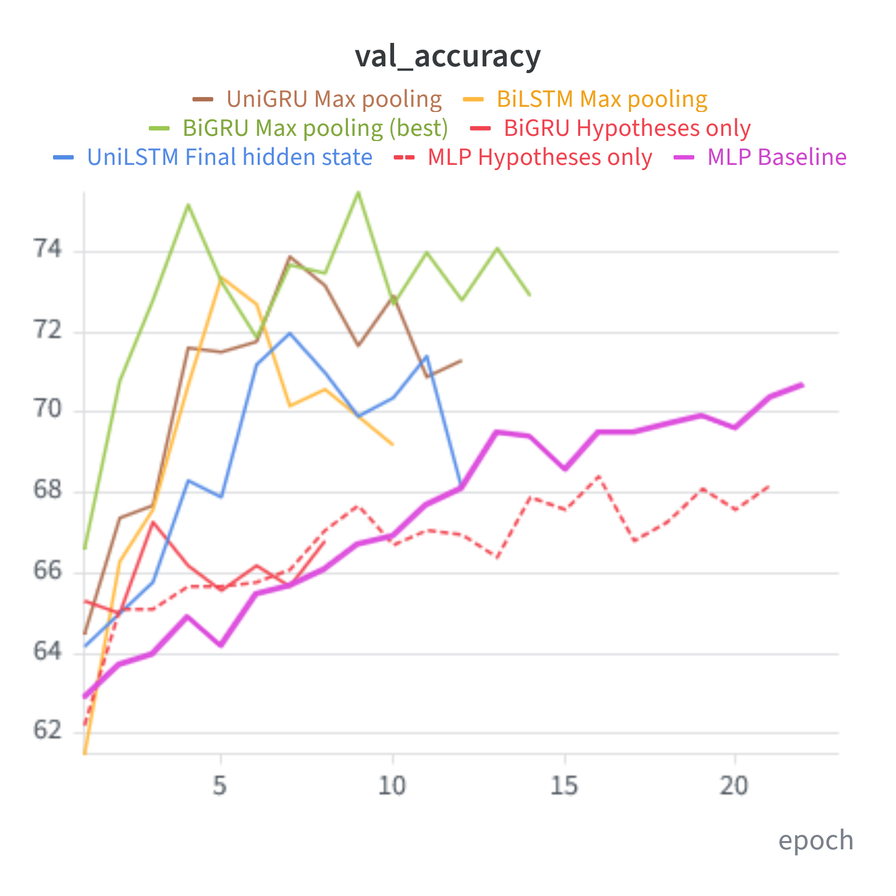
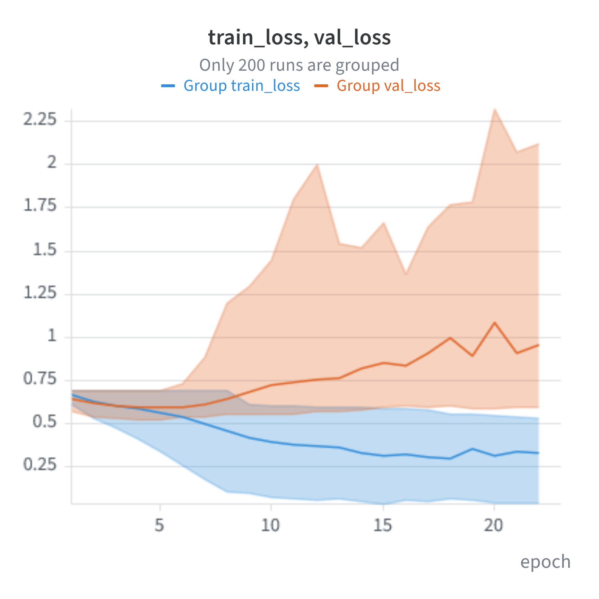

<!-- _paginate: false -->

# Project 1: Word Embeddings & RNNs on ART

**Jay Hawkes** · NLP HS26

**AI tools used:** Claude (Claude Code) for coding help and slide drafting
**Prior work:** word2vec GoogleNews-300 (Mikolov et al., 2013), max-pooling on hidden states (Conneau et al., 2018)

<!--
Required by the course: list every AI tool in the intro. I wrote/reviewed all code and can explain every line.
-->

---

# Preprocessing

| Decision | Why |
|---|---|
| **word2vec GoogleNews-300**, frozen | Required; 3M vocab incl. case variants |
| `nltk.word_tokenize`, drop punctuation-only tokens | Matches w2v tokens; punctuation not in vocab |
| **No lowercasing** (lowercase + digits→`#` as fallbacks) | w2v is case-sensitive and writes digits as `#` |
| No stemming / lemmatizing / stopword removal | Stems not in w2v; *a, to, of* missing anyway; negations matter |
| OOV → `<unk>` | Skipped in mean (M1), zero vector (M2) |
| Filter empty train rows; labels 1/2 → 0/1 | Noise removed, val/test untouched; 0-based for CE |
| No truncation | Short stories; packing handles length |

**OOV rate:** About 11% per split including function words (a, to, and, of). Only aboud 0.25% per split otherwise.

<!--
- Lookup order in lookup_token: exact token -> digits replaced by # -> lowercased. So "Tom" stays "Tom", "The" falls back to "the" only if needed.
- Stopwords: GoogleNews dropped very frequent words like "a", "to", "of" during training, so they become OOV anyway. Removing other stopwords would drop negations/pronouns that change which hypothesis is plausible ("He was never lost").
- Empty fields: some train rows have hypotheses without any word character (no \w). Only train is filtered so the evaluation sets stay comparable to everyone else's.
- Splits: the given train/validation/test. Validation for early stopping, sweeps and model selection; test touched only once per final model.
- OOV rate as justification: the low OOV rate shows the vocab covers the data, so no extra cleaning/spelling correction was needed.
-->

---

# Input / output format

**Paired scoring (both models):** build one input per hypothesis, score each, compare.

```
x_i = [O1 ; h_i ; O2]               i ∈ {1, 2}
s_i = f(x_i)  (scalar)              logits = [s_1, s_2]

loss = CrossEntropy(softmax([s_1, s_2]), label ∈ {0, 1})
```

- **Model 1:** `x_i` = concat of 3 mean vectors → **900-d**; batch `(B, 2, 900)`
- **Model 2:** `x_i` = token ids of O1 + h_i + O2 (chronological); batch `(B, 2, S)` + lengths, padded per batch (PAD = 0)
- **Output:** `(B, 2)` logits, prediction = argmax

<span class="why">Why: the same network scores both hypotheses → symmetric, no position bias. </span>

<!--
- Alternative would be [O1, h1, h2, O2] -> 2-class head. That lets the model learn "hypothesis in slot 1 vs slot 2" and has to learn the comparison twice.
- Mean vector: gensim get_mean_vector normalizes each word vector to unit length before averaging, ignoring <unk>.
- Batching Model 2: collate_fn flattens to 2B sequences, pad_sequence to the longest in the batch (dynamic padding, no global max length), lengths passed so padding is skipped by pack_padded_sequence.
- hyp_only mode: input is just h_i (300-d mean or h_i tokens) — used as a shortcut baseline.
-->

---


# Network architecture

<div style="display:flex; gap:40px">
<div style="flex:1">

**Model 1: embeddings + MLP**
- 900 → Linear(H) → ReLU → Dropout → Linear(1)
- Only the classifier is trained
- Best: H = 512, dropout 0.15

</div>
<div style="flex:1">

**Model 2: RNN + MLP**
- Frozen `nn.Embedding` (w2v, PAD=0 / UNK=1 zero vectors)
- **2-layer LSTM or GRU**, uni- or bidirectional, packed sequences, dropout between layers
- Pooling over the **top layer** (fwd ‖ bwd if bi): final hidden state, or mean / max over all time steps → same MLP head

</div>
</div>

<span class="why">Why: required 2-layer ReLU head. Vocab from all splits is safe since embeddings are frozen. Packing keeps padding out of the final state.</span>

<!--
- Vocab built over all splits: since embeddings are frozen and come from w2v (pretrained), adding a test word just looks up its pretrained vector; no information from test labels is used.
- LSTM vs GRU: GRU has fewer params (2 gates vs 3), often similar results on short texts. Bidirectional lets the representation see O2 and h together from both sides.
- Known weakness: in a unidirectional RNN the hypothesis sits in the middle, the final state is written last by O2 which is identical for both candidates. Bidirectional helps; mean/max pooling over all time steps of the top layer gives the hypothesis tokens a direct path to the head.
- Max pooling is per dimension: each feature takes its maximum over time, so different features can come from different tokens (as in InferSent).
- Loss: cross-entropy over the 2 scores. Optimizer: AdamW (decoupled weight decay as regularization).
-->

---

# Experiments

**Questions:** Do the models use the observations at all? Does sequence order (RNN) beat bag-of-words (mean)? LSTM vs GRU, uni vs bi? **Final hidden state vs max-pooling over time?**

- **Baselines:** chance = 50 %, hypothesis-only input (same architecture, only h_i)
- **Training:** AdamW, cross-entropy, seed 42; early stopping on **val accuracy** (patience 5, val loss as tie-break); best checkpoint kept and reloaded
- **W&B Bayesian sweeps** (maximize val acc, Hyperband early termination): lr, weight decay, dropout, hidden dims (+ batch size for MLP)
- **Separate sweep per variant** (LSTM/GRU × uni/bi × final/max-pool), so each gets its own tuning budget; **383 runs** in total
- Best run per sweep chosen on val; **test evaluated once** per selected model

<span class="why">Why max-pooling: h sits in the middle of O1 + h + O2, so the final state is written last by O2, which is identical for both candidates. Max over time gives every token a direct path to the head.</span>

<!--
- Why accuracy for early stopping: it is the task metric. Val loss starts rising earlier (overconfidence) while accuracy still improves, so stopping on loss would stop too early.
- Why separate sweeps: one joint sweep would let Bayes optimization concentrate on whichever variant looked good early, and the others would be under-tuned -> unfair comparison.
- Fixed for RNN: 2 layers (required), batch size 64. Search ranges: lr 1e-4..3e-3 (RNN), 1e-4..1e-2 (MLP), log-uniform; wd log-uniform; dropout 0..0.5.
- Max-pooling is per dimension over the top-layer outputs of all (unpadded) time steps; same output size as the final state (H, or 2H if bi), so the MLP head is unchanged.
- Run names encode architecture + hyperparameters (suffix -max for max-pooling), tags for model/rnn type/direction/input.
- Checkpoint file is {run.name}-{run.id}.pt, test metrics written back to the run summary.
-->

---

<!-- _class: dense -->

# Results

| Model (best run per variant) | Pooling | Val acc | Test acc | Trainable params |
|---|---|---|---|---|
| Hyp-only BiGRU (h128, mlp512) | final | 67.3 | 53.7 | 759k |
| Hyp-only MLP (h512) | mean emb. | 68.4 | 51.4 | 155k |
| LSTM (h128, mlp512) | final | 72.0 | 53.8 | 419k |
| MLP (h512) | mean emb. | 72.4 | 52.3 | 462k |
| BiLSTM (h512, mlp128) | max | 73.4 | 53.9 | 9.77M |
| GRU (h128, mlp128) | max | 73.9 | **55.03** | 281k |
| **BiGRU (h128, mlp256)** | **max** | **75.5** | 54.4 | 693k |

Test set: 1532 examples → ±2.5 pts 95 % CI



<!--
- Numbers from the W&B runs table: best_val_accuracy and test_accuracy of the best run of each sweep (selected on val, never on test).
- Params computed from the dims (PyTorch counts two bias vectors per gate); frozen embeddings not counted. Check against n_params in W&B.
- 95 % CI: sqrt(0.25 / 1532) ≈ 1.3 pts standard error → ±2.5 pts.
-->

---

# Interpretation

- **Best: BiGRU + max-pool**, 75.5 val / 54.4 test (picked on val)
- **Max-pool > final state**, +1–2 pts in both bi variants
- **Val/test gap of 14–21 pts**, test 51–55 % for all models (≈ one 95% CI)
- **Hyp-only ≈ full models on test** → mostly hypothesis shortcuts
- **Val loss rises early, val acc still climbs** → overconfident, so select on acc



<!--
- Ranking on val: biGRU-max > biGRU > biLSTM-max > GRU > MLP = biLSTM > LSTM. The order is consistent with "more access to h helps", but on test the differences (max 2.1 pts) are smaller than the 95 % CI (±2.5 pts), so I can't claim the RNNs are better on unseen data.
- The biLSTM-max has 14× the params of the biGRU-max and is still worse: capacity is not the bottleneck.
- ART was adversarially filtered so BERT can't solve it -> lexical shortcuts are weak and dataset-specific; val and test contain different shortcut statistics.
- Some of the val/test gap is also selection bias: 233 runs selected on the same 1000 val examples.
- Frozen w2v + 17k training examples are not enough to learn the commonsense link between O1, h and O2; contextual pretrained models (Project 2) should do better.
- Expectations (EXPECTATIONS.md): [TODO: what I expected vs what happened]
-->


---

<!-- _paginate: false -->

# Thank you · Questions?

W&B view: [nlp_hslu_hawkes/nlp_art](https://forge.coreweave.com/wandb/nlp_hslu_hawkes/nlp_art/workspace?nw=317exzsltcc) · Code: [github.com/jaybrandon/I.BA_NLP.ART](https://github.com/jaybrandon/I.BA_NLP.ART)


---

<!-- _paginate: false -->
<!-- _class: dense -->

# References
- Conneau, A., Kiela, D., Schwenk, H., Barrault, L., & Bordes, A. (2018). Supervised Learning of Universal Sentence Representations from Natural Language Inference Data (arXiv:1705.02364). arXiv. https://doi.org/10.48550/arXiv.1705.02364
- Mikolov, T., Sutskever, I., Chen, K., Corrado, G., & Dean, J. (2013). Distributed Representations of Words and Phrases and their Compositionality (arXiv:1310.4546). arXiv. https://doi.org/10.48550/arXiv.1310.4546
